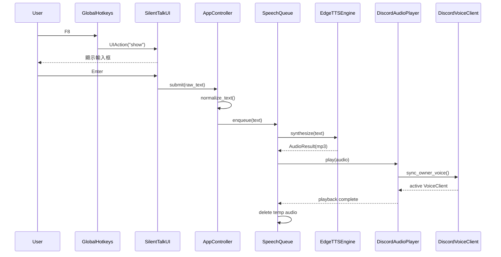

# SilentTalk Architecture

> 這份文件回答兩個問題：**「功能在哪裡？」**以及**「資料怎麼流？」**  
> 如果只是要安裝、啟動或使用 SilentTalk，先看 [README.md](README.md)。

## 1. 一分鐘理解整個專案

SilentTalk 是一個 Windows 本機桌面程式：

1. 使用者按全域快捷鍵開啟輸入框。
2. UI 把文字交給 Controller。
3. Controller 驗證文字並送進 FIFO 語音佇列。
4. TTS 把文字合成暫存音訊。
5. Discord Voice 模組找到 Owner 目前所在的語音頻道。
6. FFmpeg / discord.py 播放音訊。
7. 播放完成後刪除暫存音訊。

核心資料流：

```text
使用者
  │
  │ F8 / F9
  ▼
hotkeys.py
  │
  ▼
ui.py
  │ submit(text)
  ▼
controller.py
  │
  ├── text.py              文字正規化與驗證
  │
  ▼
speech_queue.py            FIFO / cancel / job lifecycle
  │
  ├── tts/edge.py          文字 → MP3
  │
  └── discord_voice.py     MP3 → Discord Voice
```

## 2. 想改什麼，先去哪裡

| 想修改的功能 | 先看 | 通常還會碰到 |
|---|---|---|
| F8 輸入框、按鈕、視窗行為 | `silenttalk/ui.py` | `app.py` |
| F8 / F9 全域快捷鍵實作 | `silenttalk/hotkeys.py` | `config.toml`, `silenttalk/config.py` |
| 新增快捷句、UI 內操作 | `silenttalk/ui.py` | `silenttalk/phrases.py` |
| 文字長度、空白、換行規則 | `silenttalk/text.py` | `silenttalk/config.py` |
| TTS 聲音、速度、音高、音量 | `config.toml` | `silenttalk/tts/edge.py` |
| 換另一個 TTS 引擎 | `silenttalk/tts/base.py` | `silenttalk/tts/edge.py`, `controller.py`, `config.py` |
| 播放順序、排隊、取消 | `silenttalk/speech_queue.py` | `controller.py` |
| Bot 跟隨 Owner 的邏輯 | `silenttalk/discord_voice.py` | `config.py` |
| Discord 連線 / 重連 / 換頻道 | `silenttalk/discord_voice.py` | `controller.py` |
| Bot Token / Owner ID | `.env` | `silenttalk/config.py` |
| 一般可調參數 | `config.toml` | `silenttalk/config.py` |
| 程式啟動與元件組裝 | `app.py` | `controller.py` |
| Windows 第一次安裝流程 | `啟動 SilentTalk.cmd` | `requirements.txt` |
| 啟動 / TTS / Voice 實機檢查 | `silenttalk/smoke.py` | `app.py` |
| Log 格式與寫入位置 | `silenttalk/logging_setup.py` | 各模組的 `logging` 呼叫 |
| App 狀態名稱 | `silenttalk/state.py` | UI / queue / Discord 模組 |

## 3. Repository 結構

```text
SilentTalk/
├─ app.py                       # Composition root / 程式入口
├─ config.toml                  # 非敏感、可調整設定
├─ .env.example                 # Bot Token / Owner ID 範本
├─ requirements.txt             # Runtime dependencies
├─ requirements-dev.txt         # Test / lint dependencies
├─ 啟動 SilentTalk.cmd           # Windows bootstrap / launcher
├─ README.md                    # 使用方式
│
├─ silenttalk/
│  ├─ __init__.py
│  ├─ config.py                 # 設定模型、載入與驗證
│  ├─ controller.py             # UI 與 async backend 的協調層
│  ├─ discord_voice.py          # Discord Voice routing + playback
│  ├─ hotkeys.py                # Win32 global hotkeys
│  ├─ logging_setup.py          # JSON file logging
│  ├─ phrases.py                # 快捷句 persistence / CRUD
│  ├─ smoke.py                  # Voice / TTS 實機 smoke gates
│  ├─ speech_queue.py           # FIFO jobs + cancel lifecycle
│  ├─ state.py                  # AppState
│  ├─ text.py                   # 文字 normalization / validation
│  ├─ ui.py                     # Tkinter UI
│  └─ tts/
│     ├─ __init__.py
│     ├─ base.py                # TTSEngine protocol + AudioResult
│     └─ edge.py                # EdgeTTS implementation
│
└─ tests/
   ├─ test_config.py
   ├─ test_discord_config.py
   ├─ test_edge_integration.py
   ├─ test_owner_routing.py
   ├─ test_player.py
   ├─ test_queue.py
   ├─ test_smoke.py
   ├─ test_text.py
   ├─ test_voice_config.py
   └─ test_voice_monitor.py
```

## 4. 元件責任

### `app.py` — Composition Root

`app.py` 不負責真正的 TTS 或 Discord 邏輯，主要做「組裝」：

- 設定 logging。
- 呼叫 `load_settings()`。
- 處理 `--voice-smoke` / `--tts-smoke`。
- 建立 `AppController`。
- 建立 `SilentTalkUI`。
- 把 Controller 的方法當 callback 傳給 UI。
- 啟動 Controller，再進入 Tkinter main loop。

重要 wiring：

```text
SilentTalkUI.submit
      │
      └────────► AppController.submit

SilentTalkUI.stop
      │
      └────────► AppController.stop_playback

SilentTalkUI.shutdown
      │
      └────────► AppController.shutdown
```

因此 UI 不需要知道 TTS、Discord 或 queue 的實作。

---

### `silenttalk/ui.py` — Tkinter UI

責任：

- 建立置頂輸入 popup。
- Enter 送出文字。
- Shift+Enter 換行。
- Esc 收起並清空未送出文字。
- 顯示狀態。
- 提供停止播放與退出按鈕。
- 接收 GlobalHotkeys 產生的 UI action。

UI 透過 callback 與 backend 溝通：

```python
submit: Callable[[str], None]
stop_playback: Callable[[], None]
shutdown: Callable[[], None]
```

這個邊界很重要：**UI 不直接 import 或操作 Discord / TTS。**

若新增「快捷句」，最自然的入口就是這裡；快捷句最後仍應走原本的 `submit(text)`，不要繞過 Controller。

---

### `silenttalk/hotkeys.py` — Windows 全域快捷鍵

使用 Win32 API：

- `RegisterHotKey`
- `GetMessageW`
- `UnregisterHotKey`

目前只接受 F1–F12 類型的按鍵名稱。

它自己有一條背景 thread，因此不直接改 Tkinter widget。Hotkey callback 只把 `UIAction` 丟進 UI 的 thread-safe queue，再由 Tkinter thread 處理。

---

### `silenttalk/controller.py` — 協調層

Controller 是 UI 與 async backend 之間的橋。

它建立：

- 一條專用 asyncio event loop。
- 一條 `silenttalk-async` daemon thread。
- 一個暫存資料夾。
- `DiscordVoiceClient`。
- `EdgeTTSEngine`。
- `SpeechQueue`。
- `DiscordAudioPlayer`。

送出文字時：

```text
AppController.submit(raw_text)
  │
  ├─ normalize_text(...)
  │
  └─ schedule SpeechQueue.enqueue(text)
```

Controller 也是目前真正選擇「使用 EdgeTTS」的地方。雖然 TTS 已有 Protocol 抽象，但目前仍由 Controller 直接建構 `EdgeTTSEngine`，因此若要讓 TTS engine 可插拔，還需要把建構策略抽出來。

---

### `silenttalk/text.py` — 純文字規則

只做 deterministic、meaning-preserving normalization：

- CRLF / CR → LF。
- Unicode NFC normalization。
- 壓縮行內多餘空白。
- 最多保留兩個連續換行。
- 拒絕空字串。
- 拒絕超過 `max_text_length`。

這一層不碰 UI、不碰 TTS、不碰 Discord，因此很容易單元測試。

---

### `silenttalk/speech_queue.py` — 語音工作佇列

核心物件：

- `SpeechJob`
- `JobState`
- `SpeechQueue`
- `AudioPlayer` Protocol

Job 狀態：

```text
QUEUED
  ↓
SYNTHESIZING
  ↓
PLAYING
  ↓
DONE
```

另外可能進入：

```text
FAILED
CANCELLED
```

Queue 是單 worker FIFO：一次只合成 / 播放一個 job。

取消不是只清 pending queue。它用 `generation` 使「正在合成、但尚未播放」的舊工作失效，並呼叫 player.stop() 停止目前播放。

音訊使用完會在 `finally` 裡刪除。

---

### `silenttalk/tts/base.py` — TTS 抽象邊界

`TTSEngine` Protocol 定義：

```python
initialize()
synthesize(text) -> AudioResult
shutdown()
```

`AudioResult` 是 TTS 與播放器之間的資料契約。

好處是 `SpeechQueue` 不需要知道底下是 EdgeTTS、其他雲端 TTS 或本機模型。

目前限制：`config.py` 與 `controller.py` 還明確限定 EdgeTTS，所以抽象層已存在，但尚未做到 runtime plugin 化。

---

### `silenttalk/tts/edge.py` — EdgeTTS Adapter

責任：

- 若沒指定 voice，查詢 zh-TW voices。
- 優先選 Female zh-TW voice。
- 使用 rate / volume / pitch。
- 把結果寫到暫存 MP3。
- timeout / 空檔案視為失敗。
- 失敗時清除暫存檔。

這層會把文字送給 `edge-tts` 所使用的外部服務；程式本身則不把輸入全文寫入 SilentTalk log。

---

### `silenttalk/discord_voice.py` — Discord Voice

分成兩個主要角色：

#### `DiscordVoiceClient`

負責：

- Discord Gateway 連線。
- 只開啟 `guilds` 與 `voice_states` intents。
- 尋找 `OWNER_USER_ID` 所在的語音頻道。
- Owner 換頻道時跟隨。
- Owner 跨 Server 時斷舊連新。
- Owner 離開時依設定斷線。
- 清理 stale VoiceClient。
- 低頻 voice monitor / reconnect backoff。

它沒有寫死 Guild ID 或 Voice Channel ID。

#### `DiscordAudioPlayer`

負責：

- 播放 `AudioResult`。
- 使用 `discord.FFmpegOpusAudio`。
- 每次播放前重新確認 Owner voice routing。
- 播放中若 transport 失敗，不重播同一句，避免回音。
- `stop()` 停止目前音訊。

---

### `silenttalk/config.py` — 設定邊界

敏感資料來自 `.env`：

```dotenv
DISCORD_BOT_TOKEN=
OWNER_USER_ID=
```

一般設定來自 `config.toml`：

- `[app]`
- `[tts]`
- `[discord]`
- `[audio]`

最後轉成 immutable dataclass：

```text
Settings
├─ AppConfig
├─ TTSConfig
├─ DiscordConfig
└─ AudioConfig
```

`Settings.validate_runtime()` 目前主要檢查 FFmpeg。

---

### `silenttalk/phrases.py` — 快捷句資料層

`QuickPhraseStore` 負責本機快捷句的 persistence 與 CRUD：

- `load()`
- `add(text)`
- `update(index, text)`
- `delete(index)`

資料存在 repo 根目錄的 `quick_phrases.json`，使用 UTF-8 JSON 字串陣列。寫入時先寫 `.tmp` 再 replace，避免一般寫入途中留下半份 JSON。

`ui.py` 只負責「怎麼顯示、怎麼操作」，不自己處理 JSON。快捷句送出時仍呼叫原有 submit callback，因此 Controller / Queue / TTS / Discord 不需要知道文字來源。

前九句在 F8 popup 中對應 `Ctrl+1`～`Ctrl+9`；雙擊列表項目也可直接送出。

---

### `silenttalk/state.py` — UI / Runtime 狀態契約

`AppState` 是跨模組共用的狀態名稱：

```text
STARTING
READY
OWNER_NOT_IN_VOICE
VOICE_CONNECTED
SYNTHESIZING
SPEAKING
ERROR
SHUTTING_DOWN
```

Queue、Discord、Controller 可以回報狀態，但 UI 負責呈現。

---

### `silenttalk/logging_setup.py` — Log

寫入：

```text
silenttalk.log
```

每行為 JSON，包含：

- timestamp
- level
- logger
- event
- exception（有例外時）

現有核心流程記錄 job id、字數、延遲、錯誤類型等資訊，而不是把使用者輸入全文當一般 log 寫入。

---

### `silenttalk/smoke.py` — 實機 Gate

提供兩條不經一般 UI 的驗證路徑：

```text
--voice-smoke
固定 440 Hz WAV
→ Discord Voice
```

```text
--tts-smoke
固定文字
→ EdgeTTS
→ Discord Voice
```

用途是把問題切開：先證明 Discord Voice 可播放，再證明 TTS → Discord 整條鏈可用。

## 5. 執行緒與 Async 模型

SilentTalk 同時有三種主要執行上下文：

```text
┌──────────────────────────────┐
│ Tkinter / Main Thread        │
│ ui.py                        │
│ 所有 widget 更新             │
└──────────────┬───────────────┘
               │ UIAction queue
               ▲
┌──────────────┴───────────────┐
│ Global Hotkey Thread         │
│ hotkeys.py                   │
│ Win32 message loop           │
└──────────────────────────────┘

┌──────────────────────────────┐
│ Async Backend Thread         │
│ controller.py                │
│ asyncio event loop           │
│                              │
│ SpeechQueue                  │
│ EdgeTTS                      │
│ Discord Client / Voice       │
└──────────────────────────────┘
```

設計原則：

- Tkinter widget 只在 Tkinter thread 操作。
- Hotkey thread 不直接操作 UI。
- UI 的同步 callback 透過 Controller 排程 async coroutine。
- Discord / TTS / queue 的 async 工作集中在 backend event loop。

若新增功能，應避免從 backend thread 直接修改 Tkinter widget。

## 6. 主要 Runtime Flow

### 6.1 一般送出文字



### 6.2 F9 停止

```text
F9
→ GlobalHotkeys
→ UIAction("stop")
→ UI._poll_actions()
→ AppController.stop_playback()
→ SpeechQueue.cancel_all()
→ pending jobs = CANCELLED
→ current job = CANCELLED
→ DiscordAudioPlayer.stop()
```

### 6.3 Owner 換語音頻道

```text
Discord voice_state_update
→ DiscordVoiceClient
→ 確認事件是否為 Owner / Bot
→ 等待 cache 短暫 settle
→ sync_owner_voice()
→ 找 Owner 現在所在 channel

同 Server：
move_to(new_channel)

跨 Server：
disconnect old
→ connect new
```

## 7. 啟動流程

一般 Windows 使用者從：

```text
啟動 SilentTalk.cmd
```

開始。

Launcher 目前負責：

1. 檢查 `config.toml`。
2. 第一次使用時從 `.env.example` 建立 `.env` 並開記事本。
3. 尋找 Python 3.12；必要時用 winget 安裝。
4. 建立 `.venv`。
5. 安裝 `requirements.txt`。
6. 尋找 FFmpeg；必要時用 winget 安裝。
7. 用 `load_settings()` 驗證設定。
8. 以 `pythonw.exe app.py` 啟動 GUI。

`--check` 可只驗證 launcher 前置條件而不開 GUI。

## 8. 外部依賴與信任邊界

Runtime dependencies：

```text
discord.py[voice] 2.7.1
edge-tts          7.2.8
python-dotenv     1.1.1
```

外部系統：

```text
SilentTalk
├─ Discord Gateway / Voice
├─ EdgeTTS 所使用的外部語音服務
└─ FFmpeg executable
```

本機敏感資料：

- Discord Bot Token
- Owner Discord User ID

Token 應只存在本機 `.env`，且 `.env` 必須維持在 Git ignore 範圍內。

## 9. 測試如何對應架構

| Test | 主要保護的邊界 |
|---|---|
| `test_config.py` | env / TOML 載入、驗證、錯誤條件 |
| `test_discord_config.py` | Discord intents 最小化 |
| `test_edge_integration.py` | 真實 EdgeTTS synthesis |
| `test_owner_routing.py` | 同 Server / 跨 Server / stale voice routing |
| `test_player.py` | Voice connection reuse、播放失敗不重播 |
| `test_phrases.py` | 快捷句 JSON persistence、CRUD、驗證 |
| `test_queue.py` | FIFO、cancel、暫存音訊清理 |
| `test_smoke.py` | 固定測試 WAV |
| `test_text.py` | 文字 normalization / validation |
| `test_voice_config.py` | voice reconnect 參數 |
| `test_voice_monitor.py` | monitor task shutdown |

執行：

```powershell
.\.venv\Scripts\python -m pytest -q
```

## 10. 架構原則

目前程式值得維持的幾個邊界：

1. **UI 不直接操作 Discord / TTS。**
2. **文字都先經過 Controller / text normalization 再進 queue。**
3. **SpeechQueue 只依賴 TTS / AudioPlayer 契約，不綁 UI。**
4. **Discord routing 與 TTS synthesis 分離。**
5. **Hotkey thread 不直接操作 Tkinter widget。**
6. **Bot Token 不進 `config.toml` 或版控。**
7. **已開始但中途失敗的語句不自動重播，避免 Discord 回音。**
8. **Owner routing 不寫死 Guild / Channel ID。**

## 11. 新功能應該放哪裡

### 可編輯快捷句

目前已實作：

```text
quick_phrases.json
       │
       ▼
silenttalk/phrases.py
       │ load / add / update / delete
       ▼
silenttalk/ui.py
       │
       ├─ 列表 / 新增 / 載入 / 更新 / 刪除
       ├─ Ctrl+1～Ctrl+9
       └─ submit(selected_text)
              │
              ▼
        原本完整 pipeline
```

邊界保持不變：

- `ui.py`：呈現與使用者操作。
- `phrases.py`：本機資料 persistence。
- `app.py`：建立 `QuickPhraseStore` 並注入 UI。
- Controller / queue / TTS / Discord：不用知道文字來自手打還是快捷句。

### 新 TTS Engine

保持：

```text
TTSEngine Protocol
      │
      ├─ EdgeTTSEngine
      └─ NewTTSEngine
```

但要真正做到可切換 engine，還應把 `controller.py` 中直接建立 `EdgeTTSEngine` 的地方改成 factory / provider，並放寬 `config.py` 現在只接受 `engine = "edge"` 的限制。

## 12. 目前架構的刻意取捨

這是一個小型桌面程式，但已經比單檔腳本更模組化。

優點：

- 各責任區容易單獨測試。
- UI、TTS、queue、Discord 可以局部修改。
- Agent 或人類修改時，影響範圍較容易控制。

代價：

- 一個「按 F8 然後說話」的人類操作會跨多個檔案。
- 初次讀 repo 時，不看這份地圖容易一直追 callback。

因此本文件的主要用途不是增加更多抽象，而是讓現有抽象**可導航**。
